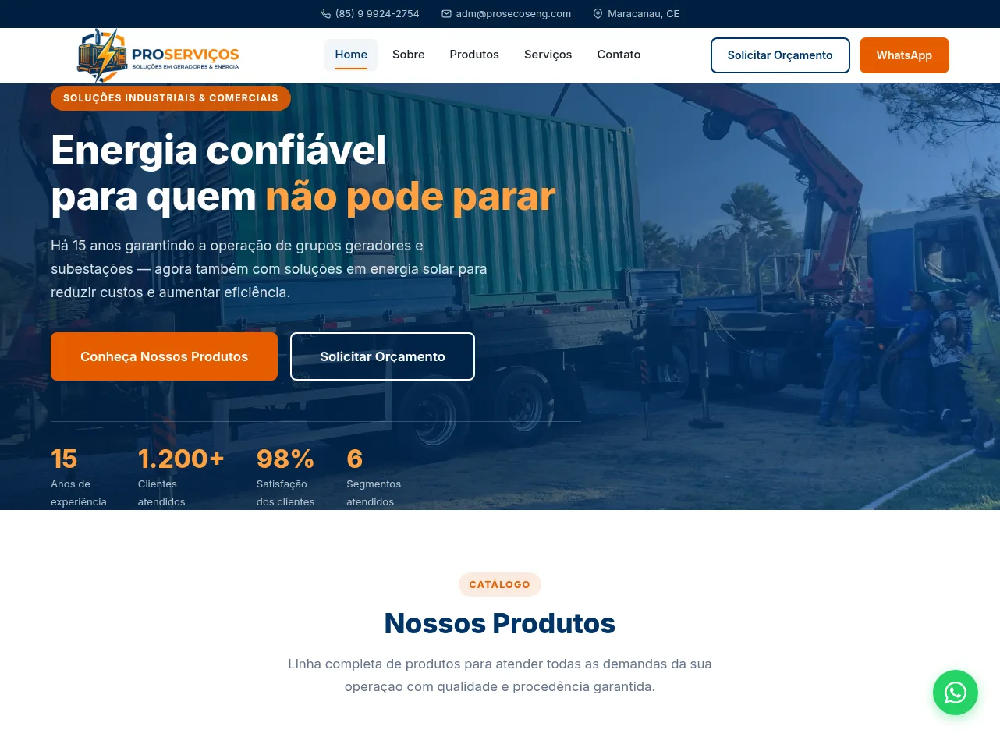
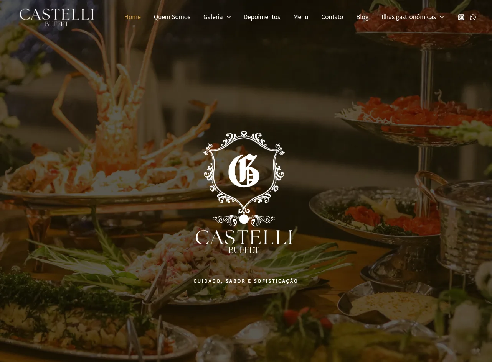

Business websites I built for companies in Ceará, Brazil, under the **Degg projects** brand.

## Famsolar

**[famsolar.com.br](https://www.famsolar.com.br/)** — corporate website for Fam Engenharia, a solar-energy company from Fortaleza.

## Proserviços Engenharia

**[proservicoseng.com.br](https://www.proservicoseng.com.br/)** — website for a company in Maracanaú that sells, rents and maintains generator sets and substations. It brings together the product catalogue, the services, the industries served and the WhatsApp quote channels. It is a static site, generated with Hugo.

## Castelli Buffet

**[castellibuffet.com](https://castellibuffet.com/)** — website for an event catering company in Fortaleza, with a gallery, menu, testimonials, blog and a page for each food station. Built on WordPress, so the catering team can update the content on their own.

