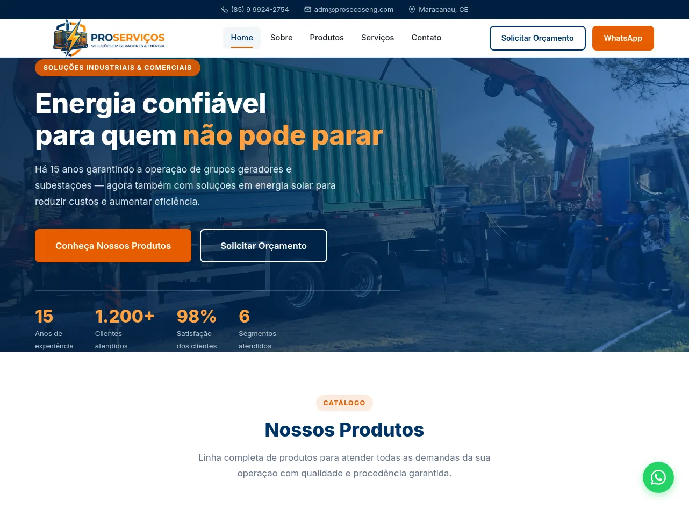
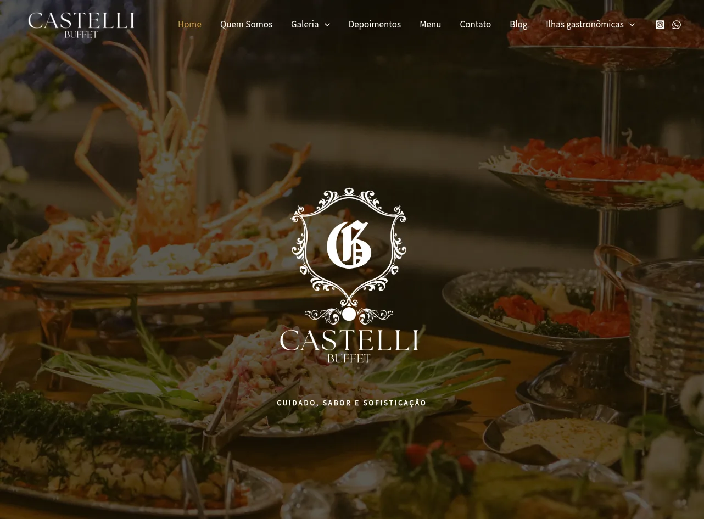

Sites institucionais que desenvolvi para empresas do Ceará, sob a marca **Degg projects**.

## Famsolar

**[famsolar.com.br](https://www.famsolar.com.br/)** — website corporativo da Fam Engenharia, empresa de energia solar de Fortaleza.

## Proserviços Engenharia

**[proservicoseng.com.br](https://www.proservicoseng.com.br/)** — site institucional de uma empresa de Maracanaú que vende, aluga e mantém grupos geradores e subestações. Reúne o catálogo de produtos, os serviços, os segmentos atendidos e os canais de orçamento por WhatsApp. É um site estático, gerado com Hugo.

## Castelli Buffet

**[castellibuffet.com](https://castellibuffet.com/)** — site de um buffet de eventos de Fortaleza, com galeria, menu, depoimentos, blog e páginas para cada ilha gastronômica. Feito em WordPress, para que a equipe do buffet atualize o conteúdo por conta própria.

